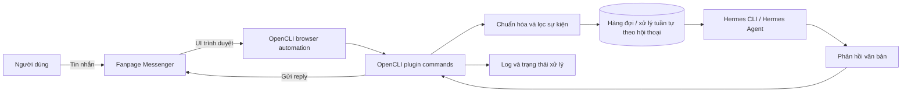
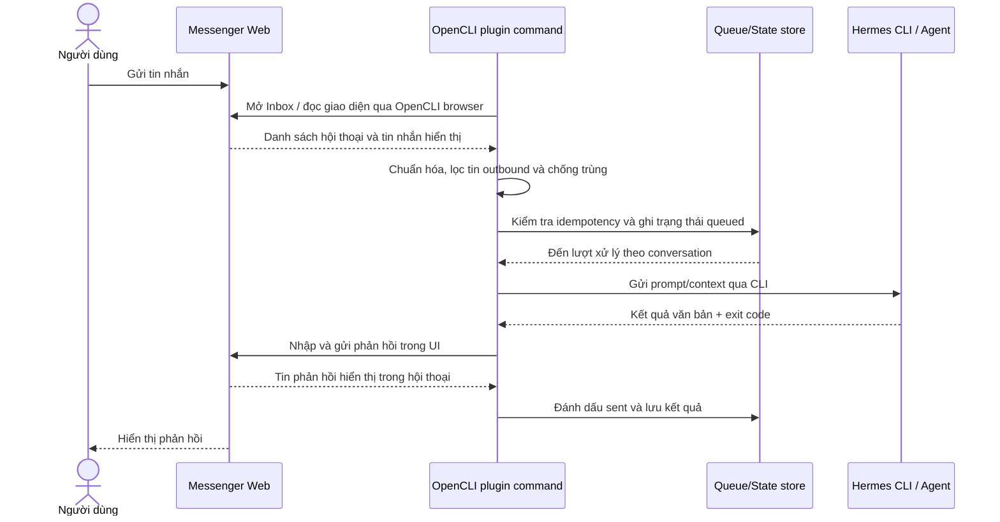

# Đặc tả kỹ thuật: OpenCLI Messenger – Hermes Agent

## Mục tiêu

Xây dựng community plugin cho OpenCLI gồm các lệnh Messenger thông thường: đọc/kiểm tra tin nhắn, xử lý tin nhắn bằng Hermes CLI và gửi phản hồi. Theo hướng dẫn Plugins của OpenCLI, plugin được cài vào `~/.opencli/plugins/<name>/`, nơi OpenCLI tự tìm file lệnh `.ts`/`.js`. Để phát hiện tin liên tục, cần một lệnh poll/watch chạy thường trực hoặc scheduler bên ngoài gọi lệnh poll.

## Phạm vi và giả định

- Tương tác hoàn toàn qua giao diện Messenger Web trong trình duyệt do OpenCLI điều khiển. Không tích hợp Facebook/Meta webhook, Graph API, Page token hoặc app secret.
- Người vận hành đăng nhập Messenger Web trước hoặc theo cơ chế browser session mà OpenCLI hỗ trợ. Plugin dùng phiên đăng nhập hiện có; không đọc mật khẩu hay xuất cookie ra log.
- Một hoặc nhiều fanpage có thể được chọn qua UI. Chỉ xử lý inbox của Page đã cấu hình/chọn.
- OpenCLI plugin cung cấp các command UI như kiểm tra trạng thái, liệt kê hội thoại, đọc tin và gửi reply. Một lệnh poll/watch hoặc scheduler gọi lệnh poll chịu trách nhiệm phát hiện tin mới; plugin không tự nhận event push từ Messenger.
- Chỉ xử lý tin nhắn inbound dạng văn bản trong MVP. Bỏ qua message do Page gửi để tránh vòng lặp. Tệp đính kèm, ảnh, audio, handoff cho người thật và gửi proactive nằm ngoài phạm vi ban đầu.
- Hermes CLI được cài đặt và đăng nhập trên máy chạy plugin. Tiến trình plugin gọi executable cục bộ; không ghép chuỗi shell từ nội dung người dùng.

## Sơ đồ thành phần



## Luồng xử lý chi tiết

1. **Poll inbox:** Lệnh OpenCLI đọc Messenger Web bằng browser session hiện có, lấy danh sách hội thoại và tin nhắn mới nhất theo cursor/watermark. Chu kỳ poll cấu hình được.
2. **Chuẩn hóa:** Chuyển dữ liệu UI/DOM thành cấu trúc nội bộ: `page_id`, `conversation_id`, `sender_id` nếu UI cung cấp, `message_id` hoặc fingerprint ổn định, `text`, `timestamp`, `direction`.
3. **Lọc và chống trùng:** Bỏ tin do Page gửi, tin rỗng/không hỗ trợ, hội thoại ngoài allowlist và tin đã xử lý. Dùng message ID nếu UI hiển thị; nếu không, tạo fingerprint ổn định từ Page, hội thoại, nội dung và timestamp.
4. **Đưa vào xử lý:** Xếp tuần tự theo `conversation_id` để giữ thứ tự; có thể xử lý các hội thoại khác nhau song song nếu browser session cho phép.
5. **Tạo ngữ cảnh cho Hermes:** Gửi nội dung, định danh hội thoại và lịch sử gần nhất theo định dạng rõ ràng. Không đưa token, cookie hoặc dữ liệu cấu hình vào prompt. Giới hạn số ký tự/lịch sử theo cấu hình.
6. **Gọi Hermes CLI:** Dùng `spawn`/Process API với executable và args tách biệt, timeout, giới hạn output, working directory được cấu hình. Truyền prompt qua stdin nếu CLI hỗ trợ; nếu chỉ hỗ trợ args thì phải tránh lộ nội dung trong process list và log. Thu stdout/stderr, exit code và thời gian chạy.
7. **Kiểm tra kết quả:** Chỉ gửi khi tiến trình kết thúc thành công và đầu ra có nội dung hợp lệ. Loại bỏ marker/metadata của CLI nếu có; áp dụng giới hạn độ dài Messenger. Lỗi hoặc timeout chuyển sang retry có giới hạn hoặc trạng thái cần xử lý, không gửi thông báo lỗi kỹ thuật cho khách.
8. **Gửi trả lời:** Mở đúng hội thoại, xác nhận Page/conversation, nhập nội dung vào composer và gửi qua UI. Kiểm tra tin outbound xuất hiện trong giao diện trước khi đánh dấu thành công.
9. **Hoàn tất:** Ghi trạng thái sent, fingerprint/message ID quan sát được trong UI, thời gian xử lý và correlation ID; giải phóng khóa hội thoại.



## Ranh giới module đề xuất

- **Plugin root:** `opencli-plugin-messenger-hermes/`, chứa `opencli-plugin.json`, `package.json`, command files `.ts`/`.js` và `README.md`. Có thể cài bằng `opencli plugin install <git-url>` hoặc cài local bằng `opencli plugin install <path>`.
- **Manifest:** `opencli-plugin.json` khai báo `name`, `version`, `opencli` compatibility range và `description`. Manifest không đăng ký từng command; từng file command tự đăng ký qua registry.
- **Package:** `package.json` dùng `type: module`, khai báo peer dependency `@jackwener/opencli` tương thích. OpenCLI plugin install tự cài dependency, liên kết package OpenCLI host vào `node_modules` và transpile TypeScript sang JavaScript. Khi cả `.ts` và `.js` cùng tồn tại, startup ưu tiên `.js` để tránh đăng ký trùng.
- **Command files:** Mỗi command import `cli` và `Strategy` từ `@jackwener/opencli/registry`, sau đó đăng ký `site`, `name`, `description`, `access`, `example`, `strategy`, `browser`, `args`, `columns` và `func`. Dùng `access: 'read'` cho lệnh đọc/kiểm tra; dùng `access: 'write'` cho thao tác gửi tin. Chọn browser/strategy theo adapter browser trong OpenCLI và xác nhận với phiên bản đang cài.
- **Messenger Web adapter:** Dùng browser session/tab do OpenCLI quản lý để mở inbox, chọn Page và hội thoại, đọc danh sách/tin hiển thị, nhận diện tin inbound mới, mở đúng conversation rồi gửi nội dung qua composer UI. Ưu tiên selector/locator theo accessibility role và label; tránh phụ thuộc class CSS sinh tự động. Adapter phải kiểm tra trạng thái login, Page đang chọn và conversation đang mở trước khi đọc/gửi.
- **Command surface đề xuất:** `opencli messenger-hermes status`, `opencli messenger-hermes inbox`, `opencli messenger-hermes reply --conversation <id> --text <text>`, `opencli messenger-hermes process --message <id>`. Lệnh `watch` chỉ nên có nếu xác nhận OpenCLI cho phép command chạy dài và có shutdown lifecycle thích hợp; nếu không, dùng scheduler gọi `inbox/process` định kỳ.
- `MessengerWebClient`: interface cho thao tác browser UI, ví dụ `checkSession`, `listConversations`, `readMessages`, `openConversation`, `sendTextReply`.
- `InboxPoller`: gọi `MessengerWebClient` theo chu kỳ/cursor, phát hiện message ID mới và đưa vào xử lý.
- `MessageNormalizer`: ánh xạ nội dung hiển thị trên Messenger Web về schema nội bộ và đánh dấu hướng tin nhắn.
- `MessageFilter`: loại tin outbound, duplicate, Page không được phép và loại nội dung ngoài phạm vi.
- `ConversationStore`: lưu idempotency key, trạng thái xử lý, cursor polling và lịch sử hội thoại tối thiểu. MVP đơn máy có thể dùng SQLite; nếu OpenCLI đã có storage chuẩn thì dùng storage đó.
- `HermesRunner`: dựng prompt, gọi Hermes CLI, timeout, parse kết quả và phân loại lỗi.
- `ReplySender`: kiểm tra độ dài/định dạng, gửi reply qua UI, retry lỗi thao tác tạm thời và xác nhận phản hồi đã hiển thị.
- `Logger`: log có cấu trúc với correlation ID, không ghi access token, cookie hoặc nội dung nhạy cảm mặc định.

## Hợp đồng dữ liệu nội bộ

```json
{
  "page_id": "page-id",
  "conversation_id": "conversation-id",
  "sender_id": "user-id-or-null",
  "message_key": "visible-id-or-stable-fingerprint",
  "text": "Nội dung tin nhắn",
  "timestamp": "ISO-8601",
  "direction": "inbound"
}
```

Các trường định danh phải được coi là opaque string; không suy ra `conversation_id` từ tên hiển thị nếu giao diện cung cấp định danh ổn định. Khi không có message ID, fingerprint cần kết hợp Page, conversation, hướng tin, nội dung và timestamp hiển thị. Nếu không thể phân biệt tin trùng một cách an toàn, không tự động gửi phản hồi.

## Tích hợp Hermes CLI

- Cô lập tích hợp trong `HermesRunner`, không gọi shell trực tiếp từ handler sự kiện.
- Cấu hình `HERMES_BIN`, args/model/profile (nếu CLI hỗ trợ), working directory và timeout.
- Mỗi lần chạy có correlation ID; liên kết với Page, conversation và message ID trong state/log.
- Đầu vào phải phân tách rõ system instruction, lịch sử hội thoại và tin nhắn mới. Xem nội dung khách gửi là dữ liệu không đáng tin cậy; không cho phép nội dung đó thay đổi cấu hình hoặc quyền của plugin.
- Quy định định dạng đầu ra mà plugin mong đợi, ví dụ plain text hoặc JSON có schema `{ "reply": "..." }`. Ưu tiên chế độ output có cấu trúc nếu Hermes CLI hỗ trợ; validate trước khi gửi.
- Không chạy lại lệnh vô hạn. Retry chỉ dành cho lỗi tạm thời; lỗi xác thực, cấu hình hoặc đầu ra sai schema cần chuyển trạng thái failed/dead-letter.

## Cấu hình và bí mật

Cấu hình đề xuất (tên biến chỉ là gợi ý, cần điều chỉnh theo chuẩn OpenCLI):

| Tên                           | Bắt buộc | Ý nghĩa                                                  |
| ------------------------------ | ---------: | ---------------------------------------------------------- |
| `MESSENGER_PAGE_NAME`        |        Có | Tên Page cần chọn trong giao diện                      |
| `MESSENGER_INBOX_URL`        | Tùy chọn | URL Messenger Web/inbox mở trong browser session          |
| `MESSENGER_POLL_INTERVAL_MS` |        Có | Chu kỳ poll inbox                                         |
| `MESSENGER_BROWSER_SESSION`  | Tùy chọn | Định danh session/browser theo cơ chế OpenCLI hỗ trợ |
| `HERMES_BIN`                 |        Có | Đường dẫn executable Hermes CLI                        |
| `HERMES_TIMEOUT_MS`          |        Có | Timeout cho một lần suy luận                            |
| `MAX_REPLY_LENGTH`           |        Có | Giới hạn nội dung gửi                                  |
| `ALLOWED_SENDER_IDS`         |     Không | Allowlist người gửi trong môi trường thử nghiệm    |

Không lưu mật khẩu hoặc cookie trong cấu hình plugin. Dùng session đăng nhập do trình duyệt/OpenCLI quản lý; nếu session hết hạn, dừng xử lý và báo người vận hành đăng nhập lại. Không in nội dung nhạy cảm của session vào log hoặc đưa vào prompt Hermes.

## Độ tin cậy và lỗi

- Idempotency theo `message_key`, cùng trạng thái `received → queued → processing → sent` hoặc `failed`.
- Retry với exponential backoff và jitter cho lỗi navigation/UI tạm thời. Có giới hạn số lần thử; lỗi kéo dài chuyển sang trạng thái cần xử lý.
- Không retry mù thao tác gửi khi không rõ lần click trước đã thành công chưa; trước khi gửi lại kiểm tra nội dung outbound mới nhất trong giao diện để tránh trả lời trùng.
- Bảo vệ khỏi vòng lặp: lưu dấu tin do Page gửi và chỉ trigger Hermes cho tin được nhận diện rõ là inbound.
- Giữ thứ tự trong cùng hội thoại; khóa có lease/timeout để phục hồi nếu worker chết.
- Phát hiện trạng thái đăng xuất, checkpoint/confirmation UI hoặc thay đổi layout; dừng gửi khi không chắc đang ở đúng Page/conversation. Giới hạn số message đọc mỗi lượt, thời gian thao tác browser và output Hermes CLI.

## Bảo mật và quyền riêng tư

- Không thu thập password, cookie hoặc token phiên khỏi browser. Chỉ thao tác trên tab/session do người dùng/OpenCLI cấp.
- Xác nhận Page và người nhận trên UI trước khi gửi; không gửi nếu locator mơ hồ hoặc giao diện ở trạng thái bất thường.
- Sanitize log; mặc định chỉ ghi ID, trạng thái, thời lượng và mã lỗi. Nội dung tin nhắn chỉ log khi bật debug có chủ đích và có chính sách lưu trữ phù hợp.
- Lưu tối thiểu dữ liệu hội thoại, đặt thời hạn lưu và hỗ trợ xóa state theo Page/conversation.
- Chạy Hermes CLI với quyền hệ điều hành tối thiểu, working directory giới hạn và không truyền secret vào prompt.

## Quan sát vận hành

Log dạng JSON nên có `correlation_id`, `page_id`, `conversation_id`, `message_id`/fingerprint, `stage`, `status`, `duration_ms`, `attempt` và `error_code`. Không ghi cookie/session. Theo dõi tối thiểu:

- số sự kiện nhận, bỏ qua, trùng, gửi thành công và thất bại;
- độ trễ từ nhận đến phản hồi;
- timeout/exit code của Hermes CLI;
- lỗi selector/navigation, đăng xuất, retry và số hội thoại/tin đang chờ.

## Kiểm tra nghiệm thu

- Tin nhắn inbound hợp lệ được chuyển đúng một lần đến Hermes và nhận được phản hồi trong cùng conversation.
- Echo/outbound message không kích hoạt vòng lặp.
- Session đăng xuất hoặc giao diện không khớp được phát hiện an toàn; không gửi vào nhầm hội thoại.
- Các conversation khác nhau có thể chạy song song, nhưng thứ tự tin trong cùng conversation được giữ.
- Timeout, Hermes exit lỗi, session hết hạn và lỗi thao tác UI được ghi trạng thái rõ ràng, không làm mất tin âm thầm.
- Secret không xuất hiện trong log, prompt hay commit.
- Plugin có lệnh cấu hình/kiểm tra kết nối theo chuẩn OpenCLI nếu framework hỗ trợ.

## Trình tự triển khai đề xuất

1. Tạo cấu trúc community plugin và đăng ký một command nhỏ theo Plugins guide; xác nhận package/registry/API với phiên bản OpenCLI mục tiêu.
2. Xác nhận browser/session API và selector strategy OpenCLI cung cấp; đăng nhập Messenger Web và chọn Page mục tiêu.
3. Viết schema tin nhắn và `MessengerWebClient` interface; tạo fake client để phát triển độc lập với browser UI.
4. Tạo `HermesRunner` chạy một prompt thử nghiệm, parse output và timeout rõ ràng.
5. Nối handler, state/idempotency, hàng đợi theo conversation và reply sender.
6. Bổ sung cấu hình, kiểm tra credential, log, retry và hướng dẫn cài đặt/vận hành.
7. Thử nghiệm trên Page sandbox/tester trước, sau đó mới bật cho Page thật.

## Trách nhiệm thành phần

- **Messenger Web:** Hiển thị inbox/tin nhắn và nhận phản hồi được nhập qua giao diện.
- **OpenCLI plugin:** Nhận/chuẩn hóa/lọc tin, điều phối trạng thái và Hermes CLI, gửi phản hồi.
- **Inbox poller/scheduler:** Gọi command đọc inbox theo chu kỳ; Messenger không push event trực tiếp vào plugin.
- **Hermes Agent:** Đọc ngữ cảnh được cung cấp, suy luận và trả nội dung theo hợp đồng đầu ra.
- **State store:** Chống trùng, giữ thứ tự và hỗ trợ khôi phục sau lỗi.
